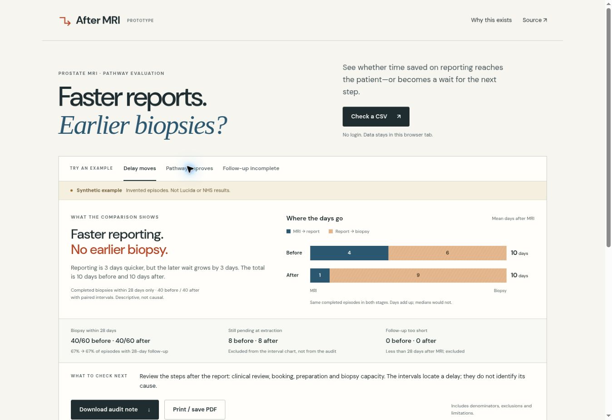

# After MRI

**Did faster MRI reporting actually get patients to biopsy sooner?**

[**Open the working demo →**](https://rounakdas07.github.io/after-mri/)

After MRI turns a five-column, anonymous pathway extract into a before-and-after comparison. It separates MRI-to-report time from the later wait to biopsy, keeps the analysed population explicit, and produces a downloadable audit note.



Built by **Rounak Das**, a medical student at the University of Nottingham, with AI-assisted research, design and development. An independent prototype for discussion with Lucida Medical's clinical team; **not commissioned, affiliated, clinically validated or endorsed** by Lucida Medical, the NHS or NICE.

## Why this question?

Pi already supports prostate MRI assessment. The Greater Manchester rollout includes a service evaluation, and Leeds describes a pathway connecting priority MRI reporting to same-day biopsy. Reporting speed and the overall interval to biopsy are different outcomes. This prototype makes that distinction visible without interpreting scans or making patient-level recommendations.

- [Greater Manchester Cancer Alliance: AI rollout and service evaluation](https://gmcancer.org.uk/ai-prostate-cancer-detection/)
- [Leeds Teaching Hospitals: same-day diagnostic pilot, 28 October 2025](https://www.leedsth.nhs.uk/news/new-ai-pilot-to-speed-up-prostate-cancer-diagnosis-in-leeds/)
- [Lucida: NICE **draft** recommendations, 27 October 2026](https://lucidamedical.com/lucida-medical-welcomes-nice-draft-recommendations-on-ai-support-for-prostate-cancer-diagnosis/)
- [Sushentsev et al., 2026: retrospective biopsy-efficiency study](https://pmc.ncbi.nlm.nih.gov/articles/PMC13282241/)

Sources were reviewed on 18 November 2026. They motivate the question; they do not supply our example numbers. No claim is made about a gap in Lucida's internal tools or final NICE guidance.

## Try it in 30 seconds

1. Open the demo. In **Delay moves**, reporting is three days quicker but biopsy is no earlier.
2. Switch to **Pathway improves**: the total interval falls by three days.
3. Switch to **Follow-up incomplete**: the tool refuses to interpret an immature cohort as a successful result.
4. Download the audit note, or open **Check a CSV** to try your own synthetic data.

All three examples are invented. They are not estimates of Pi's effect or NHS performance.

## What works

- Strict CSV parsing with clear row-level errors; no silent deletion of invalid records.
- Same complete episodes used in both stages, so mean stages add to the mean total.
- Common 28-day minimum follow-up and 28-day biopsy window.
- Counts for pending, later-completed, not-planned, unknown and immature episodes.
- Missingness, unequal completion and small-sample warnings.
- Mean, median, 90th percentile and zero-day interval counts.
- A comparability checklist carried into a plain-text audit export.
- Printable view, CSV template, synthetic example downloads and mobile layout.
- No third-party libraries, analytics, external fonts, backend or data storage.

## Input

[Blank template](template.csv) · [Displaced delay example](examples/shifted.csv) · [Improved pathway example](examples/shorter.csv) · [Immature follow-up example](examples/immature.csv)

Use **synthetic or institution-approved fully anonymous data only**. This public prototype is not a clinical data system. Calculate the intervals in your approved environment and remove names, dates, IDs and notes before using it. Local processing alone does not make a clinical deployment approved or safe.

| Column | Meaning |
| --- | --- |
| `period` | `before` or `after`. Consecutive episodes from comparable populations at one site. |
| `biopsy_status` | `completed`, `pending`, `not_planned` or `unknown`, as recorded at extraction. |
| `mri_to_report_days` | Days from MRI to the agreed report milestone. Blank if unavailable. |
| `mri_to_biopsy_days` | Days from MRI to biopsy, only for completed biopsies. Blank if unavailable. |
| `followup_days` | Days from MRI to the audit extraction cutoff. Required, even if biopsy occurred earlier. |

Exactly these five columns are accepted, in any order. Decimal intervals are supported; use a decimal point. The parser supports UTF-8 BOM, CRLF and quoted CSV cells. Blank is missing; zero is observed. Negative, non-finite, non-numeric and inconsistent times are rejected. Maximum 10,000 episodes / 1.5 MB. Deduplicate inside the source environment; without identifiers this app cannot detect duplicate episodes.

## Method and limits

Episodes with fewer than 28 days of follow-up are excluded. Among the remaining episodes, only those with a biopsy within 28 days **and** a recorded report interval enter the time comparison. Mean time from report to biopsy is calculated per episode as `mri_to_biopsy_days - mri_to_report_days`. Both stages use the same subset. Median and 90th percentile use linear interpolation.

The 28-day window is a prototype design choice, **not** the NHS Faster Diagnosis Standard, a clinical target or a NICE requirement. Other approved evaluation designs may need a different window and censoring methods.

This complete-case comparison conditions on biopsy completion and truncates longer waits. It can be biased: fewer completed biopsies may reflect incomplete follow-up, different case mix, changed biopsy decisions or capacity. Always inspect completion rates and exclusions. The remaining status labels describe extraction status and cannot reconstruct all decisions at day 28.

This is descriptive, not causal. It does not adjust for staffing, referral risk, seasonality, scanner, site or pathway changes. No statistical significance or power claim is made. The `<10` sample warning is a transparent prototype flag, not a validated threshold. The 0.05-day narrative tolerance reflects display rounding, not clinical importance. Zero-day intervals only mean same-calendar-day events when the input uses calendar-day differences.

It does not measure time to histological diagnosis, diagnostic accuracy, cancers missed, complications, quality of life, cost-effectiveness, or lives saved. Biopsy avoidance requires separate evidence and follow-up. **No biopsy planned is not a negative cancer result.**

## Privacy and deployment

The app reads the file with the browser File API; no network request sends its contents. It uses no local storage, cookies, database or telemetry. Reloading clears imported data. Exported files are the user's responsibility. GitHub Pages still receives ordinary requests for the website and static assets; follow external source links under their own policies.

The content security policy disallows connections and external scripts. All imported values are constrained numeric/enumerated fields, and dynamic UI text uses `textContent`. No identifiers or raw dates are required. A live institutional deployment would need local information-governance review, clinical validation, an agreed evaluation protocol, and an approved hosting environment.

## Run and test

Static HTML, CSS and ES modules. No package installation is needed.

```sh
node --test tests/model.test.mjs
python3 -m http.server 8000
```

Open `http://localhost:8000` (ES modules should be served over HTTP, not `file://`). GitHub Pages serves `main` at the repository root; `.nojekyll` keeps this buildless.

Tests cover displaced delay, total improvement, immature follow-up, missing values, same-day zeroes, fixed-window boundaries, inconsistent chronology, CSV parsing, formula injection, population accounting and export provenance.

[Research and build brief](docs/BRIEF.md) · [Rounak's walkthrough](docs/WALKTHROUGH.md)

## Licence

MIT for original code. DM Sans is distributed under its included SIL Open Font License. Linked publications and external names retain their respective rights.
